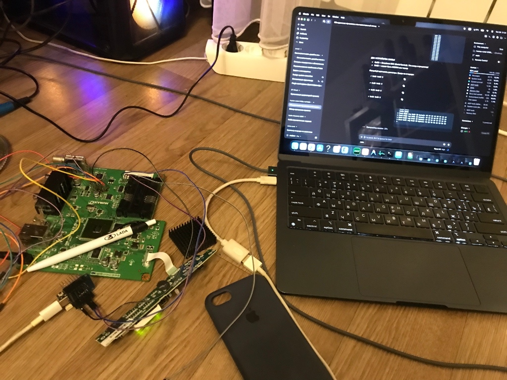

# Humax CXHD-5150C — Linux Root Access Research

Reverse engineering project targeting the OnLime/Rostelecom-branded Humax CXHD-5150C
set-top box. Goal: obtain root Linux shell access on operator-locked hardware.

> ## ВСЕ ИНТЕРФЕЙСЫ ЗАКРЫТЫ. ПРИСТАВКА — КИРПИЧ.
>
> **Проект остановлен 2026-10-28.** Приставка окирпичена: перепрошивка Y4.11
> лоадера записала 144/150 блоков (96%), E-FE на битом блоке NAND — загрузчик
> CFE уничтожен. Все отладочные интерфейсы проверены и закрыты:
>
> - **JTAG** — OTP Security Fuse пережжён (Conax CAS). Диодный тест: TDO
>   (пин 5) = 0.898V — дорожка цела, но выходной буфер навсегда отключён в
>   кремнии. Пункт "JTAG Enable" в меню — ложь, OTP необратим.
> - **BBS (I2C)** — BSC slave на 0x08 ACKает адрес и 1 байт, но все чтения
>   возвращают 0xFF. Протокол заблокирован / данные не отдаёт. Исчерпывающее
>   тестирование: raw read, 16-bit address, write-then-read, частотный свип
>   10–400 кГц, clock stretch до 150 мс — всё 0xFF.
> - **UART** — физически отключён на PCB. Диодный тест показывает OL (обрыв)
>   на пинах UART. Нулевые 0Ω резисторы не распаяны. Сканирование всех
>   скоростей (9600–1562500) — шум.
>
> Всё, что наработано, остаётся в репозитории.
>
> **Возможно, будет продолжение** с HD7000i или CXHD-5150C, если дойдут руки.
> Основная идея — **взлом через PORTAL** (оператор Ростелеком) для получения
> ключей и дампов прошивок, необходимо исследование.
>
> **Если вы в Москве и есть ненужные приставки Humax под эксперименты — свяжитесь!**

**Status (2026-10-28):** stopped. Device bricked — Y4.11 loader flash wrote only
144/150 blocks, CFE destroyed. All three debug interfaces confirmed closed:
JTAG OTP-locked (TDO buffer permanently disabled), BBS I2C slave returns only
0xFF, UART physically disconnected on PCB. Remaining viable path: direct NAND
flash programming with CH341A (NAND chip not yet identified).

## Почему приставка стала кирпичом

Попытка перепрошить загрузчик Y4.11 через USB HDF
(`build/y411_loader_repacked.hdf`, SysID `0x00000000/0xFFFFFFFF`). Прошилось
144 из 150 блоков (96%), на 145-м — E-FE (Flash Erase/Write error, битый блок
NAND). Результат: частично записанный Y4.11 — устройство не может загрузиться.

- MICOM жив (анимация загрузки на передней панели)
- BCM7213 ROM стартует, но Y4.11 падает до инициализации UART → UART молчит
- Цикл перезагрузки 13–15 с (blob-gate: нулевой блоб → прыжок в bootrom → reset)

## Что проверено и закрыто (октябрь 2026)

### JTAG — OTP заблокирован навсегда

Диодный тест всех пинов JTAG-колодки (2x7):

| Пин | Сигнал | Диод (мВ) | Вывод |
|-----|--------|-----------|-------|
| 1   | TRST   | 400       | Подтяжка на GND (900Ω), дорожка цела |
| 3   | TDI    | -295      | Норма, защитный диод |
| 5   | TDO    | **898**   | Дорожка цела, но выходной буфер ОТКЛЮЧЁН (OTP fuse) |
| 7   | TMS    | -296      | Норма |
| 9   | TCK    | -296      | Норма |
| 11  | —      | -296      | Норма |

**TDO = 0.898V** — это не обрыв дорожки (был бы OL) и не рабочий выход (был бы
~0.5V как остальные). Это характерная сигнатура **пережжённого OTP Security Fuse**:
трасса дотянута до кремния, но output buffer навсегда отключён внутри чипа.
Conax CAS требует блокировку JTAG — фьюз прожигается при первой активации CAS.

Пункт "JTAG Enable" в сервисном меню (FUSING INFO) — **враньё**. Он показывает
состояние *софтверного* бита, а не аппаратного OTP. OTP необратим.

### BBS (I2C) — slave не отдаёт данные

BBS = Broadcom Broadband Studio — 4-пиновый I2C интерфейс (VCC, SCL, SDA, GND).
BCM7213 выступает I2C Slave на адресе 0x08.

Тестирование через Wemos D1 mini (`uart/bbs_i2c/bbs_i2c.ino`):

| Тест | Результат |
|------|-----------|
| I2C scan | 0x08 (BCM7213 BSC) + 0x32 (EEPROM 14128G) |
| Запись 1 байт на 0x08 | ACK (все 256 значений) |
| Запись 2+ байт на 0x08 | NACK |
| Чтение с 0x08 (любой метод) | **0xFF** |
| Raw read без register address | 0xFF |
| 16-bit register address (r2) | TX error 3 (NACK на 2-й байт) |
| Write-then-read (STOP+START) | 0xFF |
| Частотный свип 10–400 кГц | 0xFF (400 кГц — NACK) |
| Clock stretch 40/150 мс | 0xFF |
| Indirect register 0xA6 (SkyWalker-1 протокол) | NACK (2 байта → отказ) |

BSC slave аппаратно присутствует (ACK на адрес), но данные не отдаёт.
Вероятно, тот же OTP-фьюз блокирует и BBS-доступ.

0x32 (EEPROM "14128G / AF2171"): возвращает `F2 23 75 65 2A 60 53 33` с
любого смещения — скорее всего M24128 (I2C EEPROM), не flash для CFE.

⚠️ **Перемычка около BBS: НЕ ТРОГАТЬ** — замыкает 3V на GND, вызывает срабатывание
защиты БП (писк) и отключение MICOM.

### UART — физически отключён

Диодный тест UART-пинов: **OL** (бесконечность) — дорожки физически разорваны.
На PCB отсутствуют 0Ω SMD-резисторы, которые должны соединять площадки с CPU.

Дополнительная проверка: сканирование всех стандартных и нестандартных скоростей
(9600, 19200, 38400, 57600, 76800, 115200, 153600, 230400, 250000, 460800,
500000, 921600, 1562500 бод) через USB-UART адаптер — только шум, 0 полезных
байт на всех скоростях.

Соседние площадки на PCB проверены — UART TX со стороны CPU не найден.

## Дальнейшие направления

### PORTAL (Ростелеком) — требуется исследование

Основная идея для продолжения: атака через PORTAL (оператор Ростелеком) для
получения ключей шифрования и дампов прошивок. Если получить ключи CAS и/или
полные дампы через операторскую инфраструктуру, можно обойти все аппаратные
блокировки.

### Прямое программирование NAND (CH341A)

Единственный оставшийся аппаратный путь восстановления кирпича: выпаять или
подключиться к NAND-чипу напрямую через программатор CH341A. Чип NAND на плате
пока не идентифицирован.

### Кластер дешёвых приставок

Идея: скупать приставки Humax (CXHD-5150C, HD7000i) на Avito по ~300 руб./шт.
для экспериментов. Рабочая приставка = рабочий UART + возможность дампа через
Download Mode.

---



*паяемся*

Подробный разбор BBS и JTAG — в [docs/BBS_JTAG_RESEARCH.md](docs/BBS_JTAG_RESEARCH.md).
Ранние исследования — в [docs/deepseek_research.md](docs/deepseek_research.md).

Старые предупреждения в силе: чужие прошивки из репо не шить, ключей в них нет, без
дампа CFE (Y5.06) подмена SysID ничего не даёт. Если у вас есть `.hdf`, которых нет
в репозитории — присылайте (сверяйте MD5, чтобы не было дублей).

- [JTAGenum](https://github.com/DenisovPlay/JTAGenum) — JTAG определялка для WEMOS

andreydenisov25@gmail.com, t.me/@zeniflow_support — ПИШИТЕ СЮДА.

---

## Hardware

| Component | Details |
|-----------|---------|
| SoC | Broadcom BCM7213 (BMIPS, MIPS32 LE, 256MB DDR2) |
| Loader | **partially flashed Y4.11** (144/150 blocks; original Y5.06 lost) |
| System ID | 8050.8400 (OnLime variant) |
| Flash | NAND, MTD layout confirmed |
| UART | Physically disconnected (0Ω resistors missing on PCB) |
| JTAG | **OTP-locked** (TDO buffer disabled by burned Conax CAS fuse) |
| BBS (I2C) | BSC slave at 0x08, ACKs address but all reads return 0xFF |
| MICOM | UART3 @ 115200, alive (front-panel animation running) |
| Programmer | ESP8266 Wemos D1 mini V4.0.0 — used for I2C bridge and JTAG attempts |

---

## План восстановления и запуска своего кода

| Этап | Что делаем | Критерий успеха | Статус |
|------|------------|-----------------|--------|
| 0 | Забрать Wemos | плата на руках | готово |
| 1 | Поднять JTAG | OpenOCD видит TAP/IDCODE, `halt` работает | **закрыто**: OTP fuse пережжён |
| 1a | BBS I2C | Чтение регистров через BSC slave | **закрыто**: 0xFF на все чтения |
| 1b | UART | Подключение к консоли | **закрыто**: физически отключён |
| 2 | Свой код на CPU | payload в DRAM, маркер в память/порт | заблокировано |
| 3 | Дампы | DRAM, boot ROM, CFE/лоадер из NAND | заблокировано |
| 4 | Свой загрузчик | DRAM + UART + NAND + USB, загрузка Linux | заблокировано |
| 5 | Linux с USB | v20 через JTAG → `kexec` | образ готов, JTAG закрыт |
| 6 | Постоянная загрузка | свой лоадер в NAND после бэкапа | не начато |
| — | **PORTAL** | ключи/дампы через инфраструктуру оператора | **исследование** |
| — | **NAND напрямую** | CH341A программатор | не начато |

**Почему так.** Y-loader — единственное, что мешало: он проверяет 262-байтный
заголовок партиции и 256-байтный блоб, а без валидного блоба уходит в bootrom и
сбрасывает чип. JTAG и свой лоадер обходят и проверку, и сам Y-loader целиком —
нам не нужны ни подпись, ни блоб, ни Download Mode. Но JTAG закрыт OTP-фьюзом.

**Что даст свой лоадер.** Полный контроль над загрузкой: свой UART-консоль,
чтение NAND, USB host/storage, загрузка ELF/raw-ядра с флешки и передача управления
ядру. Первая ступень — минимальный Linux 2.6 (v20): он уже умеет USB/FAT32 и kexec,
из него можно прыгнуть на основной образ с флешки, не дожидаясь полностью своего
bare-metal лоадера. Дампы HD FOX T2 / FOXSAT-HDR (тот же BCM7405) используем как
эталон инициализации CFE/USB/NAND, а не как прошивку для записи.

---

## What Has Been Accomplished

### Firmware format fully reversed (HDF)
- 20-byte outer header + 12-byte block headers; CRC16/ARC throughout
- Double-wrapped: partition payload is itself an inner HDF file
- 262-byte partition header: `[01 00][256B blob][4B used_size]`
- Block flags: `0x00` = plaintext copy, `0x80` = LZRW1 compressed, `0x08` = AES encrypted
- Compression codec identified as LZRW1 (Ross Williams), extracted from `FV3Dll.dll`
- Packer: `build/hdf_packer.py`; CRC16 verified byte-exact against stock HDFs and
  all generated trigger/kits

### Y4.11 loader fully disassembled (999 functions, 72 576 instructions)
- Boot chain: `boot_app() → copier(0x800B0000) → jalr target`
- Copier copies only type-1 blocks, ignores `addr` field; destination always `0x800B0000`
- **No crypto checks at boot** — plaintext blocks load and execute without signature validation
- AES+SHA256 scheme: `sign = AES(SHA256(content), master_key)`; master key extracted
- Master key (Y4.11): `6ac5e95712d6cd298239c5c1e2540fbe`
- Signature slot written to EEPROM after successful update, not re-verified at boot

### Boot failure root cause identified ("blob-gate")
- The 262B partition header contains a 256-byte blob validated by the loader at boot
- Null blob → loader jumps to bootrom `0xBFE00000` → chip reset → 13–15 s cycle
- This is the sole reason our custom kernels did not persist past the logo screen
- Solution in the old plan: obtain the blob from a Y5.06 CFE dump
- **Not on the current critical path** — JTAG + custom loader bypasses this gate entirely

### Serial update protocol decoded (WDN4OAK / FV3Dll.dll) — deferred
- Protocol: `PC → 0x06` (CONNECT), then `STB → byte / PC → 0x06` (ACK per byte)
- Total transfer size: `0x62000` bytes (401 408) in `0x2000`-byte chunks
- `UploadData` / `DownloadData` / `UploadSystemID` exports identified
- Python dump tool: `tools/humax_serial_dump.py`
- **Unusable on the bricked box** (no loader → no Download Mode); kept for later

### MICOM identified as UART3 (not I2C)
- `open64("/dev/ttyS2")` + `B115200 CS8` confirmed from HD FOX T2 userland binary
- No periodic watchdog feeding required — the 15 s cycle is purely the blob-gate
- MICOM packet format: `[cmd][total_len][sub/seq][payload...][additive_checksum]`

### Custom kernel infrastructure built
- Cross-compiler: `mipsel-linux-uclibc` (stblinux toolchain)
- Kernel: `stblinux-2.6.18-7.1`, patched load address `0x800B0000`
- PIC self-relocating stub: copies image to `0x800AFAE0`
  (= `0x800B0000 − 0x520`) before jumping to kernel entry; `stub_v15.S` additionally
  disables the BCM7213 SoC watchdog
- Entry point at `+0x508` per CCX app-header convention
- Initramfs with BusyBox, static IP, netconsole broadcast to `255.255.255.255:6666`
- Build runs in Docker (`build/Dockerfile`); script expects the repo at `/data`
  and uses `/build` as the work directory

### v20 kernel built (Linux 2.6.18, BCM7213 mipsel)
- **`hdf_work/vmlinux_v20.elf`** — 2.7 MB ELF, entry `0x802AC000`, loads at `0x800B0000`
- Load segments: `0x800b0000` (text) and `0x80290000` (data/bss); entry points at
  `kernel_entry` near `__init_begin` — i.e. at the **end** of the image, not at its start
- Compiled with: kexec, USB host/storage, FAT32; the raw variant prepends the
  self-relocating stub
- Purpose: load via JTAG `load_image` → Linux in RAM → `kexec` to any kernel from USB
- **`hdf_work/custom_kernel_v20.bin`** — raw binary (2.5 MB), stub + kernel
- The raw variant is packed with `stub_v14.S` (no SoC-watchdog kill). The JTAG/ELF
  path does **not** execute the stub at all, so this only matters for the abandoned
  flash path. `stub_v15.S` adds the watchdog kill and is kept for a future build.

### Flash kits v10–v19 (historical)
- `build/flash_kit/` contains the full experiment set: type-4 SysID probes,
  zero-blob kernels, real-blob and humidify variants, full-rootfs image
- Type-4 HDF block confirmed working on our Y5.06: SysID changed to arbitrary values
  and restored — loader processes type-4 without signature verification
- These kits are kept as evidence/reference only; **do not flash them**

### Y5.06 SysID confirmed: `0x80508400`
- `build/trigger_exact_sysid.hdf` (sysid_min=sysid_max=0x80508400) → flashed OK (P000→END)
- Y5.06 has no wildcard SysID path (FFFF/FFFF → E-ID, 0000/0000 → E-ID)
- Y4.11 wildcard path exists at `0x833917a0` but only in the Y4.11 loader

---

## Build

The v20 script is written for the Docker image in `build/Dockerfile`:

```bash
docker build --platform linux/amd64 -t humax-build build
docker run --rm -it --platform linux/amd64 -v "$PWD:/data" \
  humax-build /data/build/build_firmware_v20.sh
```

Outputs:

- `hdf_work/vmlinux_v20.elf` — load with JTAG (`load_image` + `resume 0x802AC000`)
- `hdf_work/custom_kernel_v20.bin` — stub + kernel, raw image for the flash path

Notes:
- The script has hard-coded `/build` and `/data` paths; run it only in the container.
- The kernel partition limit is 2 MB, but `MAX_KERNEL_SIZE` is still 4 000 000 in the
  script (legacy check). The current v20 kernel is 2.5 MB and is **not** flashed.
- On Apple Silicon the container runs under amd64 emulation; the build script retries
  the compiler on QEMU crashes.

---

## JTAG attempt (Wemos D1 mini) — OTP locked

Actual wiring used (silkscreen labels of LOLIN D1 mini V4.0.0):

| Humax | Wemos | Signal |
|---|---|---|
| 9 | **14 SCK** | TCK |
| 3 | **12 MISO** | TDI |
| 7 | **13 MOSI** | TMS |
| 5 | **4 SDA** | TDO |
| 1 | **16** | TRST |
| 2/4/6/8/10 | **GND** | GND |

Software path:

- `uart/jtagenum/JTAGenum/JTAGenum.ino` — сканирование пинов (Serial 115200).
- `uart/esp8266_serial_bitbang/esp8266_serial_bitbang.ino` — serial remote_bitbang
  прошивка (без WiFi, UART 500000).
- `uart/serial_bridge.py` — мост USB serial ↔ TCP `127.0.0.1:3335`.
- `uart/esp8266_remote_bitbang/esp8266_remote_bitbang.ino` — WiFi-вариант, не
  использовался в финале.
- `uart/probe_meter/probe_meter.ino` — Wemos-прозвонка/вольтметр (4 SDA/12 MISO/A0).

**Результат: OTP Security Fuse пережжён.** TDO (пин 5) показывает 0.898V в
диодном режиме — дорожка дотянута до кремния, но выходной буфер навсегда
заблокирован. JTAG восстановлению не подлежит.

⚠️ **Никакого 3.3 В напрямую на pin 1.** Wemos уходил в защиту; TRST/TDO
подтягивать только через 10к или внутренний pull-up (JTAGenum: `r` → Pullups ON).

---

## Serial Dump (WDN4OAK) — deferred

The protocol and tool are ready, but the method is **not usable on the current brick**:
it needs the loader to enter Download Mode, and the loader is gone. Revisit it when
the custom loader or v20 kernel brings UART up.

Reference for later:
```bash
pip3 install pyserial
python3 tools/humax_serial_dump.py /dev/tty.usbserial-XXXX stb_cfe.bin
```
Connect CP2102: TX → STB RX, RX → STB TX, GND → GND. Power on the STB while holding
the front panel button to enter Download mode.

---

## Repository Structure

```
docs/
  HDF_FORMAT.md              — HDF binary format, byte-exact specification
  BBS_JTAG_RESEARCH.md       — BBS I2C и JTAG OTP: технический разбор, результаты тестов
  LOADER_FULL_AUDIT.md       — Y4.11 disassembly audit, boot chain, backdoors
  LOADER_Y411_RE.md          — Y4.11 RE notes: AES keys, MICOM, CCX conventions
  V10_EXPERIMENTS.md         — experiment log v10–v15
  MICOM_PROTOCOL_AND_WDN4OAK.md — MICOM UART3, serial protocol, LZRW1
  EXHAUSTIVE_ASSET_AUDIT.md  — inventory of every project asset
  claude-loader/analys.md    — latest loader analysis: blob-gate, boot gates, ROP notes
  deepseek_research.md       — CFE/loader/JTAG research; final JTAG findings

build/
  build_firmware_v20.sh      — current kernel build (Docker)
  stub_v14.S / stub_v15.S    — PIC relocating stubs (v15 adds SoC watchdog kill)
  hdf_packer.py              — HDF pack/unpack tool
  flash_kit/                 — historical flash kits v10–v19 (do not flash)

tools/
  humax_serial_dump.py       — WDN4OAK serial dump tool (deferred)
  wdn4oak/                   — WDN4OAK installer files (FV3Dll.dll, WDN4OAK.exe)
  humidify-ubuntu-1.0.4      — official HDF tool (run in Docker)

uart/
  bbs_i2c/                   — BBS I2C bridge sketch (Wemos → BCM7213 BSC slave)
  uart_scan.py               — multi-baud UART scanner (macOS IOSSIOSPEED)
  jtagenum/JTAGenum/         — JTAGenum for Wemos D1 mini — finds JTAG pin mapping
  esp8266_serial_bitbang/    — serial remote_bitbang firmware (final path, 500000 baud)
  serial_bridge.py           — USB serial ↔ TCP localhost:3335 bridge for OpenOCD
  probe_meter/               — Wemos continuity tester / A0 voltmeter
  pin_test/                  — simple pin tester for Wemos
  esp8266_remote_bitbang/    — WiFi remote_bitbang variant (not used in final)
  openocd_bcm7405.cfg        — OpenOCD config for BCM7213 MIPS EJTAG

firmwares/
  genuine/                   — stock firmware images (OnLime, PRIMACOM 5100C)
  ia_archive/                — Internet Archive finds (contains the Y4.11 loader)
  foxsat/                    — HD FOX T2 images (mipsel relative, custom fw works)

loaders/
  cfe_hdfoxt2.bin            — HD FOX T2 CFE (mipsel reference)
  cfe_foxsat_u754.bin        — FOXSAT-HDR U7.54 loader (big-endian reference)
  loader_from_hdfoxt2_type0.raw — loader extracted from HD FOX T2 HDF

hdf_work/
  loader_full.asm            — annotated Y4.11 full disassembly
  vmlinux_v20.elf            — JTAG-loadable kernel (entry 0x802AC000)
  custom_kernel_v20.bin      — raw stub+kernel image (flash path)
  cfe_hdfoxt2.elf            — HD FOX T2 CFE wrapped as ELF (entry 0x87000840)
  foxt2_rootfs/              — extracted HD FOX T2 rootfs

kernel/stblinux-2.6.18-7.1/  — kernel source tree with our patches
```

The full 393 192-byte Y4.11 loader is at
`firmwares/ia_archive/extracted/FPXCCX10016_Y411/1.hdfbin-0-000000.raw`.

---

## Related Hardware

### Direct clones (same PCB, cross-flashable)

| Model | Operator | CAS | Notes |
|-------|----------|-----|-------|
| **Humax HD 7000i** (= CXHD-5151) | Dom.ru / ER-Telecom (RU) | Conax | Byte-for-byte identical HDF, differs by 6 bytes (SysID + CRC). Confirmed cross-flashable without hardware modification. Firmware versions: RUCCAA 1.00, 1.20. |
| **Humax CXHD-5100C** | Various EU cable operators | Conax | Same GPL kernel config cluster as CXHD-5150C. |
| **Humax CXHD-5000C** (-FI, -TELE2) | Tele2 FI/SE/EU | Conax | Same kernel branch; -TELE2 / -FI are operator SKUs. Stock firmware confirmed cross-flashable to HD 7000i profile. |
| **Humax DIGI+C HD** | DIGI (RO/HU) | Conax | Same kernel config cluster in GPL sources. |

All of the above share the BCM7213 mipsel SoC, HDF firmware container format,
Y-loader CCX family, and Linux 2.6.18 kernel tree. All findings from this project
apply directly.

### Irdeto variant (same loader family, different CAS)

| Model | Operator | CAS | Service ID | Notes |
|-------|----------|-----|-----------|-------|
| **Humax IRHD-5100C** (/TVT) | Ziggo (NL), TVT (RU/EU) | Irdeto | 7080 | Same HDF structure and Y-loader architecture. |
| **Humax IRHD-5050C** | Ziggo (NL) | Irdeto | — | Same loader family. |
| **Humax IHDR-5200C** | Various EU | Irdeto | 7081 | Dual-tuner PVR variant, same platform. |

### Reference platform (working custom firmware, same SoC family)

| Model | Region | Notes |
|-------|--------|-------|
| **Humax HD FOX T2** | UK (Freeview DVB-T2) | BCM7405 mipsel. Active hummy.tv community with working custom firmware. Primary reference for HDF format, CFE/USB/NAND init, MICOM protocol. |
| **Humax HDR FOX T2** | UK (Freeview DVB-T2 PVR) | Same SoC as above. Rootfs fully extracted in this project; `humaxtv` binary used to reverse MICOM/ttyS2 protocol. |

The HD FOX T2 / HDR FOX T2 hummy.tv custom firmware (`nosettop` kernel cmdline arg,
`/etc/init.d` modifications) is the proven end-state we are replicating on the CXHD-5150C.

---

## Key Technical Notes

- The Y-loader **does not verify signatures at boot** — only during USB/OTA update
- The `origlen` field in block headers has no bounds check — potential overflow vector
- `keyidx` in block flags has no bounds check — out-of-bounds key selection
- MICOM watchdog is **not** a concern for a running Linux kernel unless the MICOM driver
  is absent; the boot cycle is caused solely by blob validation failure
- `nosettop` kernel command-line argument skips `humaxtv` and drops to console
  (confirmed on HD FOX T2; expected to work on CXHD-5150C)
- In v20 the kernel's `kernel_entry` is linked at the **end** of the image
  (`0x802AC000`), while the image start is zeros. A loader that jumps to the image
  base must either load the ELF and use its entry point, or place a trampoline
  `j kernel_entry` at offset 0.
- JTAG loading does not need the HDF container at all: `load_image` maps ELF segments,
  `resume` starts at the entry point. The custom loader can do the same from USB.

---

## Known Issues / TODO

- **All debug interfaces closed.** JTAG OTP-locked, BBS returns 0xFF, UART traces cut.
  Only remaining hardware path: direct NAND programming (CH341A).
- `build/build_firmware_v20.sh` still packs the raw image with `stub_v14.S` (no WDT
  kill) and prints a stale "Builder v8" banner. Harmless for the JTAG/ELF path; switch
  to `stub_v15.S` (or rebuild) if a flashable v20 image is ever needed.
- The kernel-size check in the script is 4 MB while the actual partition is 2 MB.
- `tools/humax_serial_dump.py` never ACKs the first received byte, which likely
  deadlocks the byte-by-byte protocol; fix before using the serial path again.
- No full NAND dump exists yet; the NAND restore fallback is blocked.
- NAND chip on the board not yet identified — needed for CH341A approach.

---

## References

- BCM7213 BMIPS MIPS32 architecture (BCM7405 in reference platforms)
- MIPS EJTAG specification v2.6+ (IR length 5)
- LZRW1 compression: Ross Williams, 1991 (public domain)
- JTAGenum: https://github.com/DenisovPlay/JTAGenum
- hummy.tv community research on HD FOX T2 / HDR FOX T2
- OpenOCD `remote_bitbang` driver
- Broadcom Broadband Studio 3 (BBS) documentation
